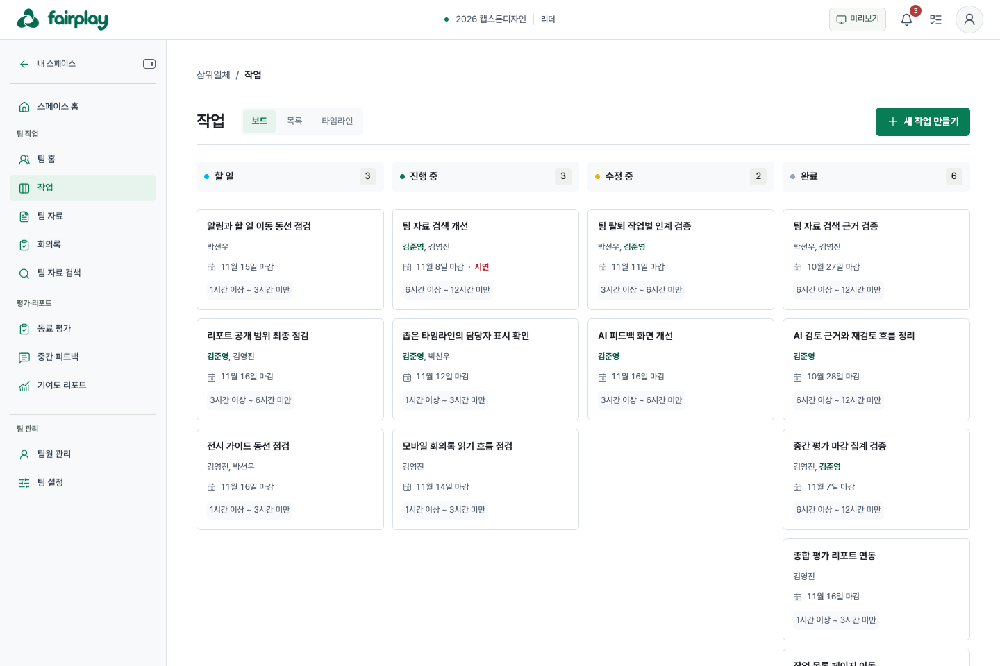
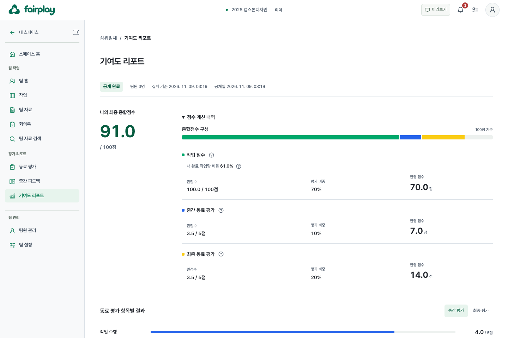
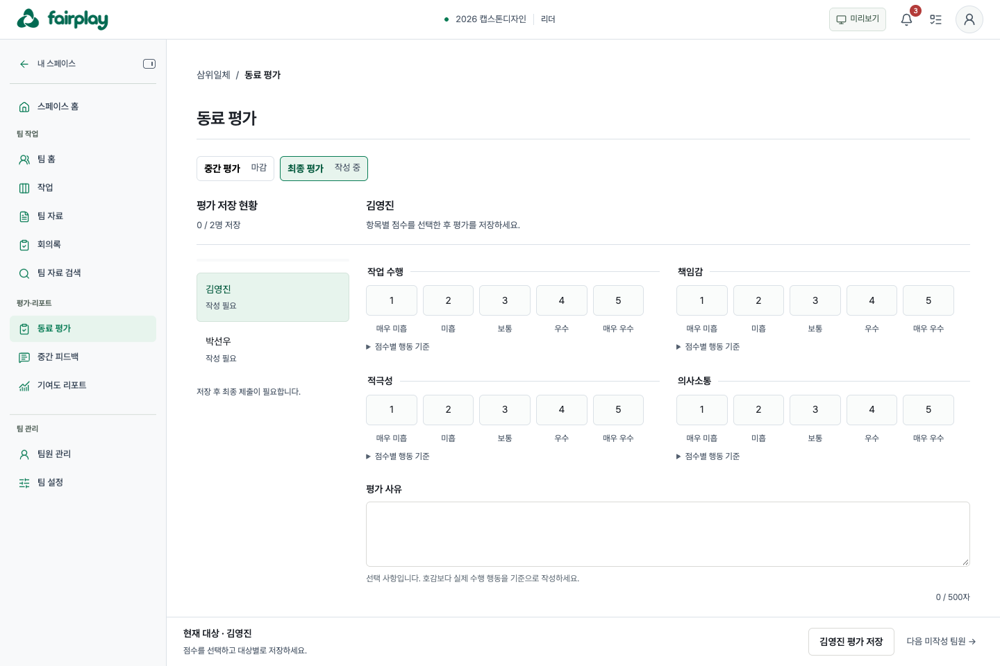
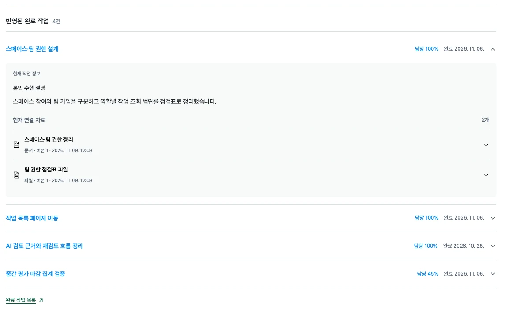
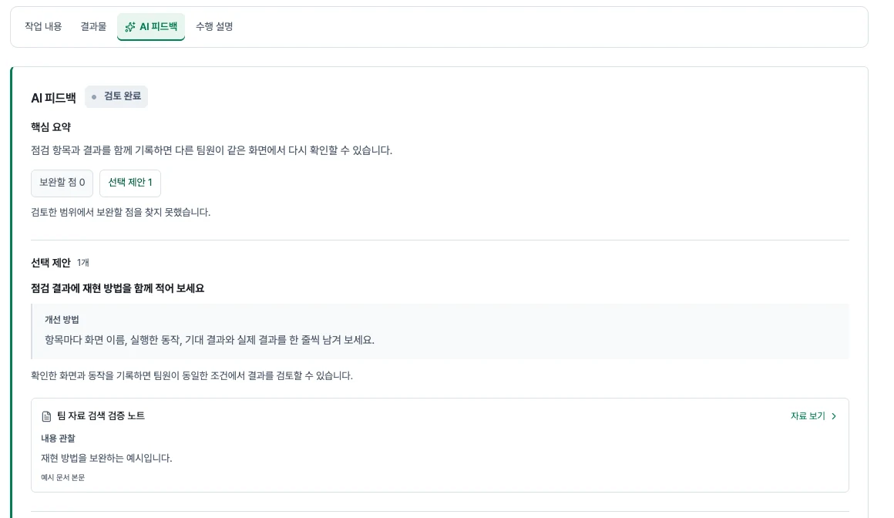
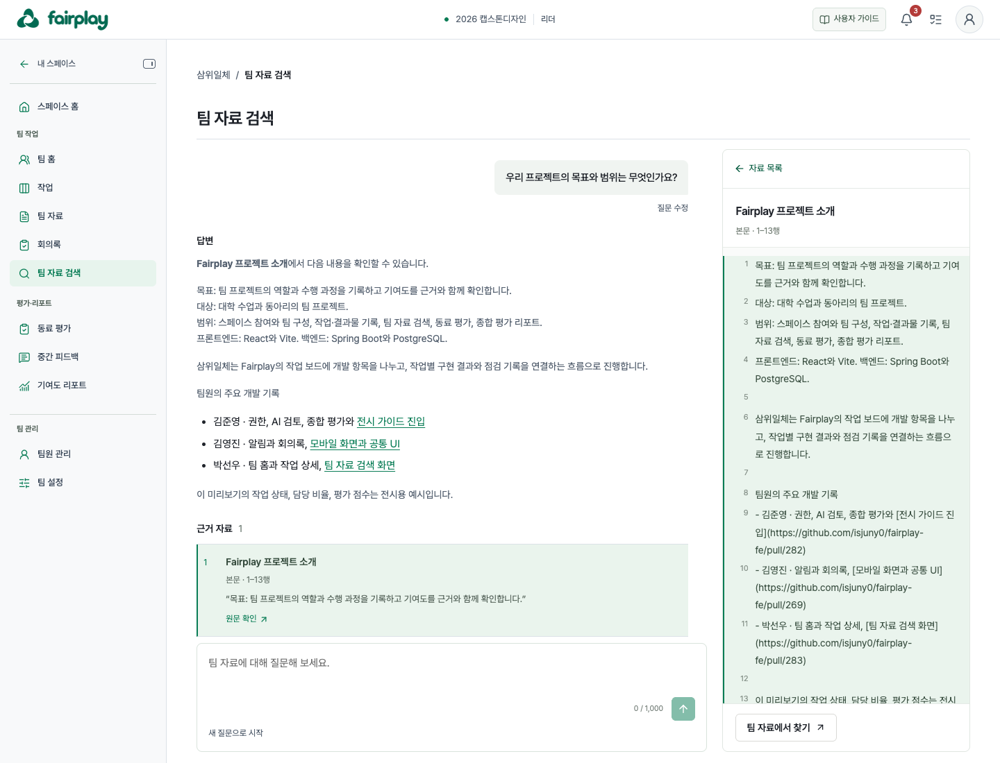
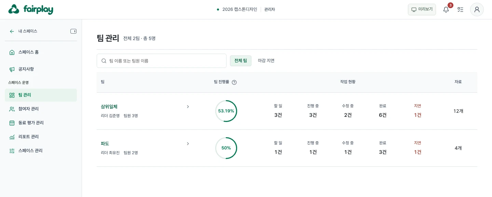
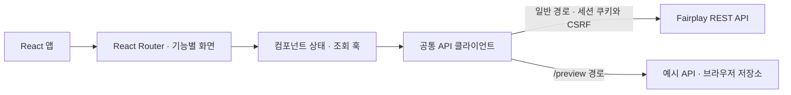

# Fairplay 프론트엔드

**팀 프로젝트에서 누가 무엇을 했는지, 그 기여가 어떻게 평가됐는지 확인하는 협업 관리 서비스입니다.**

팀원은 작업을 나누고 수행 설명과 결과물을 남깁니다. 관리자가 리포트를 공개하면 팀원은 완료 기록과 동료 평가가 반영된 본인의 종합점수와 산정 근거를 확인할 수 있습니다.



## 서비스 미리보기

| 체험 | 시작 방법 |
| --- | --- |
| [자유 탐색](https://fairplay-fe.vercel.app/preview) | 헤더의 미리보기 메뉴에서 팀 리더·팀원·스페이스 관리자 등 역할과 진행 상황을 선택합니다. |
| [전시 사용자 가이드](https://fairplay-fe.vercel.app/preview/exhibition) | 팀원 또는 관리자 탭에서 작업 완료, 동료 평가 제출, 리포트 생성·공개 등의 가이드를 선택합니다. |

계정 없이 예시 데이터로 체험할 수 있습니다. 저장·제출·공개는 브라우저의 미리보기 상태에 반영됩니다. 이 문서의 화면은 Fairplay 미리보기에서 캡처했습니다.

## 주요 기능과 화면

### 1. 작업 관리

보드·목록·타임라인에서 작업을 확인합니다. 담당자는 작업 상세에 결과물과 수행 설명을 남기고 작업을 완료합니다. 보완이 필요하면 수정 중으로 전환해 다시 완료할 수 있습니다.

### 2. 동료 평가와 기여도 리포트

팀원은 중간·최종 평가에서 대상별 점수와 사유를 저장한 뒤 제출합니다. 관리자는 제출 현황을 확인하고, 평가가 마감되면 팀별 리포트를 생성·검토·공개합니다. 팀원은 공개된 본인 리포트에서 100점 만점 종합점수, 항목별 반영 비중과 완료 작업 근거를 확인합니다.



<details>
<summary>동료 평가 작성과 완료 작업 근거 화면</summary>





</details>

### 3. AI 피드백

담당자가 요청하면 작업 설명과 결과물을 바탕으로 보완할 점과 선택 제안을 보여줍니다. 제안에 연결된 근거에서 자료를 열고, 수정 권한이 있으면 편집으로 이어갈 수 있습니다.



### 4. 팀 자료 검색

팀 자료에 질문하면 답변과 인용 근거를 볼 수 있습니다. 데스크톱에서는 오른쪽 패널에서 원문이나 추출 텍스트의 인용 위치를 함께 확인합니다.



### 5. 역할별 협업과 운영

팀원과 리더는 팀 홈에서 일정·작업을 확인하고 자료와 회의록을 공유합니다. 스페이스 관리자는 팀별 진행률, 지연 작업, 평가 제출과 리포트 공개 상태를 관리합니다.

<details>
<summary>관리자 팀 관리 화면</summary>



</details>

## 기술 스택

| 영역 | 기술과 사용처 |
| --- | --- |
| 화면과 라우팅 | **React 19**로 기능별 화면을 구성하고, **React Router 7**로 작업·팀·관리자 상세의 주소와 조회 조건을 관리합니다. |
| 개발과 빌드 | **Vite 6**로 로컬 개발 서버와 배포용 번들을 구성합니다. |
| 스타일 | **CSS**의 공통 토큰으로 화면의 상태 색상과 간격을 맞추고, **Pretendard**와 **Lucide React**를 글꼴과 아이콘에 사용합니다. |
| 문서 | **react-markdown**과 **remark-gfm**으로 팀 자료와 회의록의 마크다운을 렌더링합니다. |
| 검증 | **Node.js 테스트 러너**로 계산·검증 로직을, **Playwright**로 화면의 전환과 입력 흐름을 검증할 수 있습니다. |

## 프론트엔드 구조



| 위치 | 역할 |
| --- | --- |
| [`src/components/`](src/components/) | 라우트별 화면과 공통 UI. [`AppRoutes.jsx`](src/components/AppRoutes.jsx)가 팀·스페이스·관리자 상세 경로를 연결합니다. |
| [`src/hooks/`](src/hooks/), [`src/lib/`](src/lib/) | 조회 상태, 화면 이동, 입력 검증, 상태 판정과 점수 표시 |
| [`src/api/`](src/api/) | 인증과 공통 오류 처리, 기능별 요청 함수 |
| [`src/mock/`](src/mock/) | 미리보기 API, 예시 데이터와 가이드 시나리오 |

## 주요 구현

- **미리보기와 역할별 화면**. 로그인 경로와 미리보기는 업무 화면을 공유합니다. 공통 요청 함수가 `/preview`에서 예시 API로 분기하며, 가이드는 자유 탐색과 저장 범위를 분리합니다. 로그인 경로의 화면은 역할에 맞는 메뉴와 액션을 표시하고, 실제 접근과 변경 권한은 서버가 검증합니다. [미리보기 진입 코드](src/components/PreviewApplication.jsx) · [공통 요청 코드](src/api/client.js)
- **작업 완료·평가 제출·리포트 공개**. 작업 상태와 담당자별 수행 설명, 연결 결과물에 따라 완료 조건을 표시합니다. 팀원 평가의 임시 저장과 최종 제출, 관리자 리포트의 생성과 공개는 각각 별도 단계로 처리합니다. 수정 요청이 버전 충돌로 실패하면 입력을 보존하고 최신 내용을 다시 확인할 수 있게 합니다. [작업 상세](src/components/TaskDetail.jsx) · [동료 평가](src/components/PeerEvaluation.jsx) · [리포트 관리](src/components/ReportReview.jsx)
- **AI 대기 상태와 검색 맥락**. AI 피드백은 검토 대기·진행 중인 동안 경과 시간에 따라 조회 간격을 늘리고, 브라우저 탭이 숨겨지면 조회를 멈춥니다. 팀 자료 검색은 같은 팀으로 돌아올 때 최근 답변과 질문 초안을 복원합니다. 인용을 열면 해당 자료 버전과 위치를 확인합니다. [AI 피드백](src/components/AiReview.jsx) · [팀 자료 검색](src/components/TeamRagSearch.jsx)

## 로컬 실행과 테스트

Node.js 22를 사용합니다.

```bash
npm ci
npm run dev
```

[로컬 미리보기](http://localhost:5173/preview)는 백엔드 없이 실행할 수 있습니다. Google 로그인과 실제 API를 사용하려면 [`.env.example`](.env.example)을 `.env`로 복사해 `VITE_GOOGLE_CLIENT_ID`를 설정하고 백엔드를 실행합니다. Vite의 기본 API 프록시 대상은 `http://localhost:8080`입니다.

```bash
npm test           # 단위 테스트
npm run test:e2e   # 설치된 Chrome으로 화면 흐름 검증
npm run build      # 배포용 빌드
```

## 관련 문서

- [화면별 기능과 API 경로](docs/features.md)
- [미리보기와 전시 가이드](docs/preview.md)
- [날짜·시간 계약](docs/datetime.md)
- [공통 UI 규칙](docs/ui-conventions.md)
- [API 연동과 오류 처리](docs/api-integration.md)
- [Fairplay 백엔드 저장소](https://github.com/isjuny0/fairplay-be)
