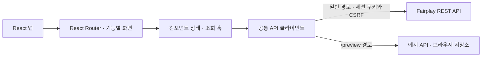

# Fairplay Frontend

Fairplay의 React·Vite 웹 프론트엔드 저장소입니다. 팀원·리더·관리자 화면, 백엔드 API 연동, 예시 데이터 기반 미리보기와 사용자 가이드를 담당합니다.

서비스 목적·주요 기능·화면·사용 흐름은 [조직 소개](https://github.com/fairplay-web)에서 확인할 수 있습니다. 이 문서는 화면 구조와 프론트엔드 개발·실행·검증 방법을 안내합니다.

[서비스 소개](https://github.com/fairplay-web) · [백엔드](https://github.com/fairplay-web/fairplay-be) · [미리보기](https://fairplay-fe.vercel.app/preview) · [사용자 가이드](https://fairplay-fe.vercel.app/preview/exhibition)

## 기술 스택

| 영역 | 사용 기술 |
| --- | --- |
| 화면·라우팅 | React 19, React Router 7 |
| 개발·빌드 | Vite 6, Node.js 22 |
| 스타일·문서 | CSS, Pretendard, Lucide React, react-markdown, remark-gfm |
| 검증 | Node.js 테스트 러너, Playwright |
| 배포 | Vercel, GitHub Actions |

## 프론트엔드 구조



| 위치 | 역할 |
| --- | --- |
| [`src/main.jsx`](src/main.jsx), [`src/App.jsx`](src/App.jsx) | 앱 진입과 인증·실행 모드 연결 |
| [`src/components/`](src/components/) | 기능별 화면과 공통 UI. [`AppRoutes.jsx`](src/components/AppRoutes.jsx)가 상세 화면 경로를 연결합니다. |
| [`src/hooks/`](src/hooks/) | 조회 상태·화면 이동·입력 복구 등 화면에서 공유하는 동작 |
| [`src/lib/`](src/lib/) | 경로·날짜·입력 검증·상태 판정·점수 표시 |
| [`src/api/`](src/api/) | 공통 요청·인증·오류 처리와 기능별 API 함수 |
| [`src/mock/`](src/mock/) | 미리보기 API·예시 자료·사용자 가이드 시나리오 |
| [`src/design-tokens.css`](src/design-tokens.css), [`src/styles.css`](src/styles.css) | 공통 스타일 토큰과 스타일 진입점 |
| [`tests/`](tests/), [`tests/e2e/`](tests/e2e/) | 단위 테스트와 브라우저 화면 흐름 검증 |
| [`docs/`](docs/) | 화면별 기능·API·미리보기·UI 연동 기준 |

## 라우팅과 화면 상태

일반 로그인 경로와 미리보기는 업무 화면을 공유합니다. 라우팅은 팀·스페이스·작업 등 조회 범위를 전달하고, 화면은 역할에 맞는 메뉴와 액션을 표시합니다. 실제 접근·변경 권한은 백엔드가 검증합니다.

공통 조회 훅은 조회 범위가 바뀌면 이전 범위의 응답을 표시하지 않도록 처리합니다. 버전 충돌 등 저장 실패 시에는 입력을 복구하고 최신 상태를 다시 확인할 수 있게 안내합니다. 날짜·시간은 한국 시간의 오프셋 없는 API 문자열을 표시하고 경과 시간 비교가 필요한 곳에서 KST로 해석합니다.

[화면별 기능과 경로](docs/features.md) · [날짜·시간 계약](docs/datetime.md) · [공통 UI 규칙](docs/ui-conventions.md)

## API 연동과 인증

기능별 모듈은 [`src/api/client.js`](src/api/client.js)의 공통 요청을 사용합니다. 실제 요청에는 세션 쿠키를 포함하고, 변경 요청은 `/api/auth/csrf`에서 받은 토큰을 서버가 지정한 헤더에 전달합니다. 파일 업로드는 `FormData`, 파일 응답은 Blob으로 처리합니다.

`INVALID_CSRF_TOKEN` 응답에는 토큰을 다시 받아 해당 요청을 한 번 재시도하고, `401`에서는 세션 만료를 처리합니다. 요청·응답 필드와 권한·업무 오류의 기준은 [백엔드 API 계약](https://github.com/fairplay-web/fairplay-be/blob/main/docs/api.md)을 따릅니다.

| 설정 | 사용처 | 기본 동작 |
| --- | --- | --- |
| `VITE_API_BASE_URL` | 실제 API 요청의 기준 주소 | 빈 값이면 같은 출처의 `/api`로 요청 |
| `VITE_API_PROXY_TARGET` | 로컬 Vite의 `/api` 프록시 대상 | `http://localhost:8080` |
| `VITE_GOOGLE_CLIENT_ID` | Google 팝업 로그인 | 실제 로그인 시 설정 필요 |

운영 API 프록시와 SPA 경로 처리는 [`vercel.json`](vercel.json)에 정의합니다. Google 클라이언트 비밀키와 OpenAI 키는 프론트엔드에 설정하지 않습니다.

[API 연동과 오류 처리](docs/api-integration.md) · [환경변수 예시](.env.example)

## 실제 서비스와 미리보기

| 실행 모드 | 진입 | 데이터 처리 |
| --- | --- | --- |
| 실제 서비스 | `/login`에서 Google 로그인 후 업무 화면으로 이동 | 백엔드 API·세션을 사용하고 서버에 변경을 저장 |
| 자유 탐색 | `/preview` | 예시 API와 브라우저 저장소 사용. 역할·상황을 선택해 화면 확인 |
| 사용자 가이드 | `/preview/exhibition` | 독립된 가이드 예시로 단계별 화면 조작. 자유 탐색 상태와 구분 |

공통 요청은 `/preview`와 하위 경로에서 예시 API로 분기합니다. 미리보기는 백엔드와 Google 로그인 없이 실행할 수 있으며, 실제 서버의 업무 데이터나 AI 호출을 사용하지 않습니다. 가이드는 실제 버튼 조작을 안내하지만 작업 완료·평가 제출의 서버 계약을 바꾸지 않습니다.

[미리보기와 가이드의 상태 관리](docs/preview.md) · [미리보기 진입 코드](src/components/PreviewApplication.jsx)

## 로컬 실행

Node.js 22를 사용합니다. 미리보기만 사용할 때는 환경파일 설정 없이 실행할 수 있습니다.

1. 의존성을 설치합니다.

```bash
npm ci
```

2. 실제 API와 Google 로그인을 사용할 경우에만 환경파일을 준비합니다. 미리보기만 사용할 때는 이 단계를 생략합니다.

```bash
cp .env.example .env
```

[환경변수 예시](.env.example)를 참고해 `.env`에 Google 클라이언트 ID·API 설정을 입력하고 백엔드를 실행합니다.

3. 개발 서버를 시작합니다.

```bash
npm run dev
```

[로컬 미리보기](http://localhost:5173/preview)에서 예시 화면을 확인할 수 있습니다. 기본 개발 서버는 `http://localhost:5173`, 기본 백엔드 프록시 대상은 `http://localhost:8080`입니다. 프록시 대상은 [`vite.config.js`](vite.config.js)와 환경변수에서 설정합니다.

## 테스트와 빌드

| 명령 | 확인 범위 |
| --- | --- |
| `npm test` | 계산·검증·상태 처리 등 단위 테스트 |
| `npm run test:e2e` | Playwright 화면 흐름 검증. 설치된 Chrome 필요 |
| `npm run test:bundle` | 번들 로딩 관련 별도 브라우저 검증 |
| `npm run build` | 배포용 번들 생성 |

브라우저 테스트 설정과 대상은 [`playwright.config.js`](playwright.config.js), [`playwright.bundle.config.js`](playwright.bundle.config.js), [`tests/e2e/`](tests/e2e/)에서 확인합니다. 예시 API 기반 테스트의 통과를 실제 로그인·서버·AI 품질 검증으로 설명하지 않습니다.

## 배포

[`Deploy production to Vercel`](.github/workflows/vercel-production.yml)은 원본 저장소의 `main` push와 수동 실행에서 동작합니다. 의존성 설치·단위 테스트 후 기존 Vercel 프로젝트 설정으로 빌드하고 운영 배포합니다. 다른 브랜치와 포크의 배포 작업은 실행하지 않습니다.

필수 GitHub Secrets와 배포 확인·재실행 방법은 [Vercel 운영 자동 배포](.github/VERCEL_DEPLOYMENT.md)에 정리했습니다.

## 상세 문서

| 문서 | 내용 |
| --- | --- |
| [화면별 기능](docs/features.md) | 화면의 동작과 연결 API 경로 |
| [API 연동과 오류 처리](docs/api-integration.md) | 요청·인증·조회 상태·저장 실패 처리 |
| [미리보기와 사용자 가이드](docs/preview.md) | 실행 모드·예시 데이터·가이드 상태 관리 |
| [날짜·시간 계약](docs/datetime.md) | 한국 시간 입력·표시와 마감 비교 |
| [공통 UI 규칙](docs/ui-conventions.md) | 공통 화면·입력·상태 표시 기준 |
| [배포 안내](.github/VERCEL_DEPLOYMENT.md) | Vercel 자동 배포와 설정 |
