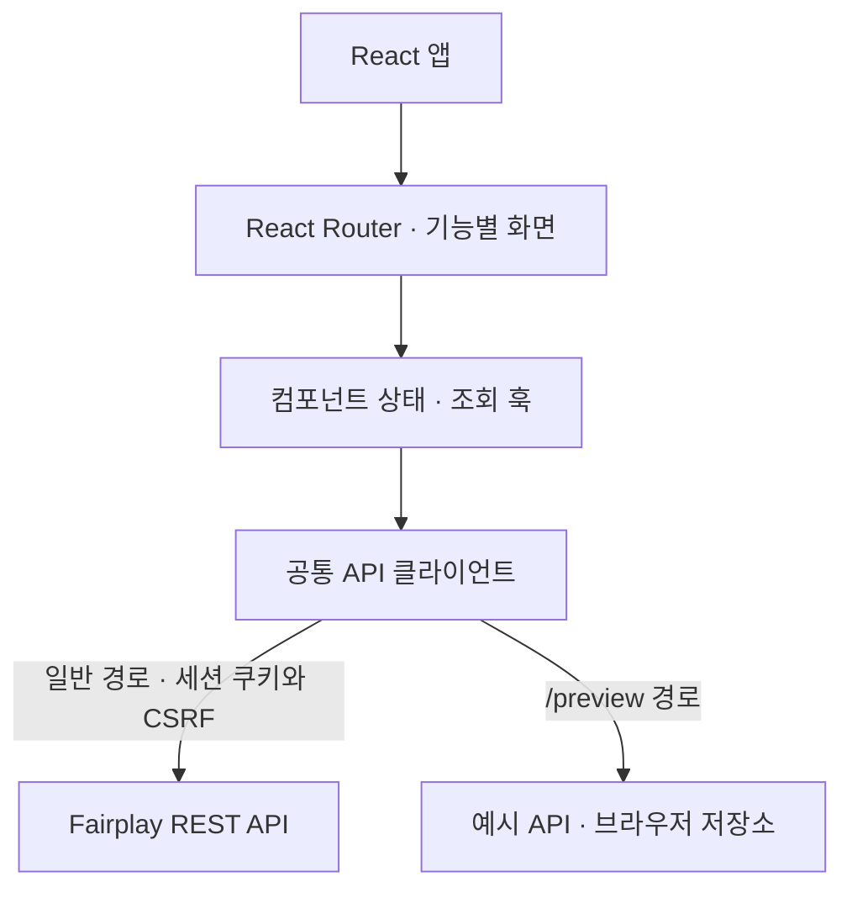

# Fairplay Frontend

Fairplay의 팀원·리더·관리자 화면과 로그인 없는 미리보기, 사용자 가이드를 제공하는 React · Vite 프론트엔드입니다.

프로젝트 소개, 주요 기능과 화면, 전체 시스템 구성은 [Fairplay 조직 README](https://github.com/fairplay-web)에서 관리합니다.

[백엔드 저장소](https://github.com/fairplay-web/fairplay-be) · [서비스 미리보기](https://fairplay-fe.vercel.app/preview) · [사용자 가이드](https://fairplay-fe.vercel.app/preview/exhibition)

## 로컬 실행과 테스트

Node.js 22를 사용합니다.

```bash
npm ci
npm run dev
```

[로컬 미리보기](http://localhost:5173/preview)는 백엔드 없이 실행할 수 있습니다. Google 로그인과 실제 API를 사용하려면 [`.env.example`](.env.example)을 `.env`로 복사해 `VITE_GOOGLE_CLIENT_ID`를 설정하고 백엔드를 실행합니다. Vite의 기본 API 프록시 대상은 `http://localhost:8080`입니다.

```bash
npm test           # 단위 테스트
npm run test:e2e   # 설치된 Chrome으로 화면 흐름 검증
npm run build      # 배포용 빌드
```

### 환경 변수

| 변수 | 용도 |
| --- | --- |
| `VITE_API_BASE_URL` | API 기본 주소. 비워 두면 `/api` 요청을 개발·배포 프록시로 전달합니다. |
| `VITE_API_PROXY_TARGET` | 로컬 개발 서버가 요청을 전달할 백엔드 주소. 기본값은 `http://localhost:8080`입니다. |
| `VITE_GOOGLE_CLIENT_ID` | Google 로그인에 사용하는 클라이언트 ID |

프론트 환경 변수는 브라우저에 포함되므로 서버 비밀 키나 배포 토큰을 넣지 않습니다.

## 기술 스택

| 영역 | 기술과 사용처 |
| --- | --- |
| 화면과 라우팅 | **React 19**로 기능별 화면을 구성하고, **React Router 7**로 작업·팀·관리자 상세의 주소와 조회 조건을 관리합니다. |
| 개발과 빌드 | **Vite 6**로 로컬 개발 서버와 배포용 번들을 구성합니다. |
| 스타일 | **CSS**의 공통 토큰으로 화면의 상태 색상과 간격을 맞추고, **Pretendard**와 **Lucide React**를 글꼴과 아이콘에 사용합니다. |
| 문서 | **react-markdown**과 **remark-gfm**으로 팀 자료와 회의록의 마크다운을 렌더링합니다. |
| 검증 | **Node.js 테스트 러너**로 계산·검증 로직을, **Playwright**로 화면의 전환과 입력 흐름을 검증할 수 있습니다. |

## 프론트엔드 구조



| 위치 | 역할 |
| --- | --- |
| [`src/components/`](src/components/) | 라우트별 화면과 공통 UI. [`AppRoutes.jsx`](src/components/AppRoutes.jsx)가 팀·스페이스·관리자 상세 경로를 연결합니다. |
| [`src/hooks/`](src/hooks/), [`src/lib/`](src/lib/) | 조회 상태, 화면 이동, 입력 검증, 상태 판정과 점수 표시 |
| [`src/api/`](src/api/) | 인증과 공통 오류 처리, 기능별 요청 함수 |
| [`src/mock/`](src/mock/) | 미리보기 API, 예시 데이터와 가이드 시나리오 |

## 주요 구현

- **미리보기와 역할별 화면**. 로그인 경로와 미리보기는 업무 화면을 공유합니다. 공통 요청 함수가 `/preview`에서 예시 API로 분기하며, 가이드는 자유 탐색과 저장 범위를 분리합니다. 로그인 경로의 화면은 역할에 맞는 메뉴와 액션을 표시하고, 실제 접근과 변경 권한은 서버가 검증합니다. [미리보기 진입 코드](src/components/PreviewApplication.jsx) · [공통 요청 코드](src/api/client.js)
- **작업 완료·평가 제출·리포트 공개**. 작업 상태와 담당자별 수행 설명, 연결 결과물에 따라 완료 조건을 표시합니다. 팀원 평가의 임시 저장과 최종 제출, 관리자 리포트의 생성과 공개는 각각 별도 단계로 처리합니다. 수정 요청이 버전 충돌로 실패하면 입력을 보존하고 최신 내용을 다시 확인할 수 있게 합니다. [작업 상세](src/components/TaskDetail.jsx) · [동료 평가](src/components/PeerEvaluation.jsx) · [리포트 관리](src/components/ReportReview.jsx)
- **AI 대기 상태와 검색 맥락**. AI 피드백은 검토 대기·진행 중인 동안 경과 시간에 따라 조회 간격을 늘리고, 브라우저 탭이 숨겨지면 조회를 멈춥니다. 팀 자료 검색은 같은 팀으로 돌아올 때 최근 답변과 질문 초안을 복원합니다. 인용을 열면 해당 자료 버전과 위치를 확인합니다. [AI 피드백](src/components/AiReview.jsx) · [팀 자료 검색](src/components/TeamRagSearch.jsx)

## 배포

운영 배포와 Repository Secrets 설정, 결과 확인 방법은 [Vercel 배포 안내](.github/VERCEL_DEPLOYMENT.md)를 따릅니다. 배포 토큰은 GitHub Actions의 Repository Secrets에서 관리합니다.

## 관련 문서

- [화면별 기능과 API 경로](docs/features.md)
- [미리보기와 전시 가이드](docs/preview.md)
- [날짜·시간 계약](docs/datetime.md)
- [공통 UI 규칙](docs/ui-conventions.md)
- [API 연동과 오류 처리](docs/api-integration.md)
- [Fairplay 백엔드 저장소](https://github.com/fairplay-web/fairplay-be)
